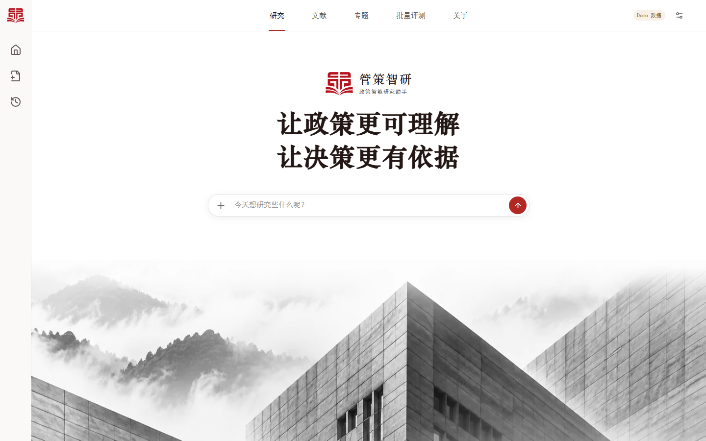
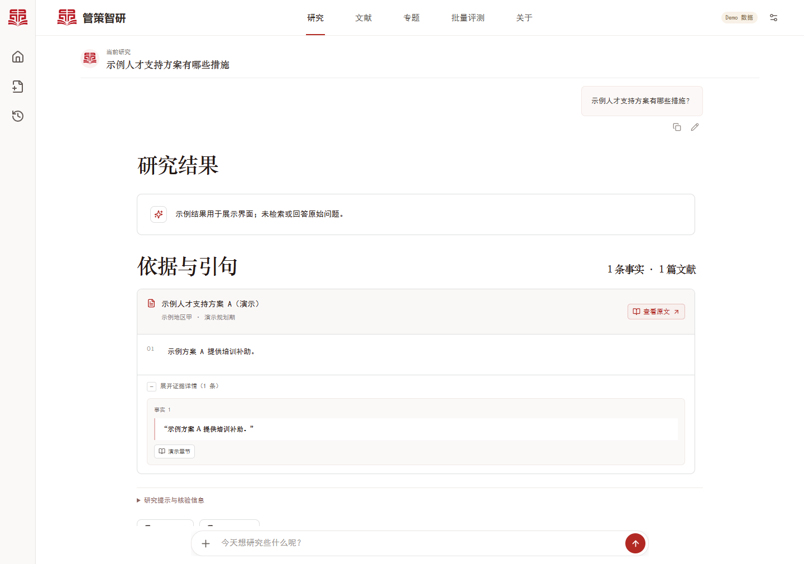
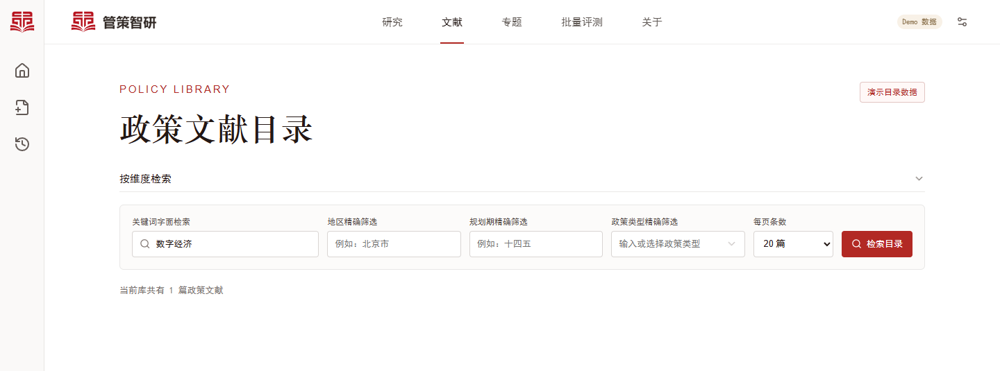

# 策研台 · 政策智能研究 Agent

> 面向政策研究人员、学生和公共事务团队，在同一工作区完成政策检索、证据核对和报告整理。

## 一、项目简介

策研台围绕政策文献开展问答、梳理与比较。用户可以从一个问题开始，也可以先从目录选取政策。Agent 检索已配置的政策知识库，组织研究结果，并保留引句和出处，方便回到原文复核。

本项目整理自[管策智研的源码提交版](https://github.com/SKD-Agent-Frontier/guance-policy-intelligence-submission)。

## 二、用途

例如，选定两份人才政策，比较它们的支持措施和申请条件，并逐项查看对应的政策原文。

## 三、项目亮点和功能点

### （一）项目亮点

| 亮点 | 说明 |
| --- | --- |
| 结论可追溯 | 从研究结果展开关联引句，再打开对应的政策原文。 |
| 证据状态可见 | 结果展示证据不足等提示。逐字核验检查引句与来源文本是否一致，结论仍需结合上下文判断。 |
| 研究过程可复用 | 按专题整理文献，在真实模式下将已完成的研究结果导出为 Word 报告或 Excel 研究表。 |

### （二）核心功能

| 功能 | 说明 |
| --- | --- |
| 政策问答 | 根据本轮检索到的政策文献回答问题，并附关联引句。 |
| 要素提取 | 按适用对象、政策工具、期限等维度整理政策内容。 |
| 文献梳理 | 围绕研究主题组织相关政策文献。 |
| 政策比较与多方案分析 | 对照指定政策或方案，呈现不同维度的差异及证据。 |
| 文献目录 | 按标题或关键词检索并阅读正文。地区等维度筛选依赖匹配的运行时资源。 |

## 四、工作流程


## 五、入门指南

### （一）前提条件

- 预览界面需要 Node.js 22 或更高版本。
- 运行真实研究还需要 Python 3.11 或更高版本、有权使用的模型接口，以及恢复好的 RAG 发布数据。[RAG 数据获取与恢复说明](rag库/README.md)

### （二）安装与启动演示

在 Windows PowerShell 中克隆仓库，安装前端依赖并启动演示模式：

```powershell
git clone https://github.com/Rainier-Z/guance-policy-intelligence-submission.git
Set-Location guance-policy-intelligence-submission/web/frontend
npm ci
$env:VITE_RESEARCH_MODE = 'demo'
npm run dev
```

### （三）配置并启动真实研究

在仓库根目录安装后端依赖：

```powershell
python -m venv agent/.venv
.\agent\.venv\Scripts\python.exe -m pip install -e ./agent
.\agent\.venv\Scripts\python.exe -m pip install -e './rag库/检索工程'
.\agent\.venv\Scripts\python.exe -m pip install -r ./web/backend/requirements.txt
```

根据 [Agent 配置模板](agent/.env.example) 创建本机私有配置，填写 `LLM_BASE_URL`、`LLM_API_KEY`、`KB_BACKEND=rag` 和 `RAG_STORE_PROJECT`。其中 `RAG_STORE_PROJECT` 指向恢复后的运行数据目录。

在仓库根目录打开 PowerShell，将示例路径替换为你的私有配置文件路径，启动后端：

```powershell
$env:GUANCE_ENV_FILE = (Resolve-Path '<你的私有配置文件>').Path
Set-Location web/backend
& ..\..\agent\.venv\Scripts\python.exe -m uvicorn app.main:app
```

在另一个 PowerShell 窗口中，从仓库根目录启动前端：

```powershell
Set-Location web/frontend
npm ci
$env:VITE_RESEARCH_MODE = 'real'
npm run dev
```

打开 Vite 输出的本地地址即可使用。自定义 API 地址时设置 `VITE_API_BASE_URL`。地区筛选还需要与 RAG 发布批次匹配的映射资源。[后端配置说明](web/backend/README.md)

## 六、示例与效果展示

### （一）最小验证场景

在演示模式中输入“示例人才支持方案有哪些措施？”，发送后展开“证据详情”，即可查看示例引句。下列截图沿用原界面的“管策智研”标识。演示使用合成文献与结果，实际政策查询需要配置真实模式。

### （二）效果展示

**研究首页**



**研究结果与引句**



**政策文献目录**



## 七、代码目录

- [Agent](agent/README.md)负责研究准备、任务执行、引文核验和结果组织。
- [RAG 检索](rag库/README.md)负责发布数据恢复、政策检索和原文读取。
- [Web 后端](web/backend/README.md)提供研究、文献目录和报告导出接口。
- [Web 前端](web/frontend/README.md)提供研究工作区、文献目录和证据界面。
